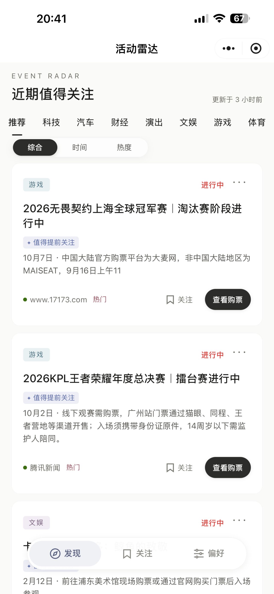
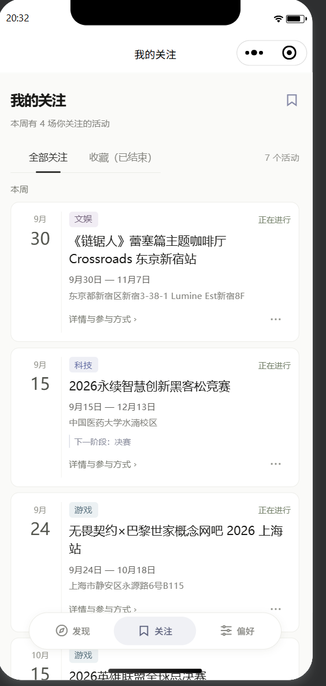
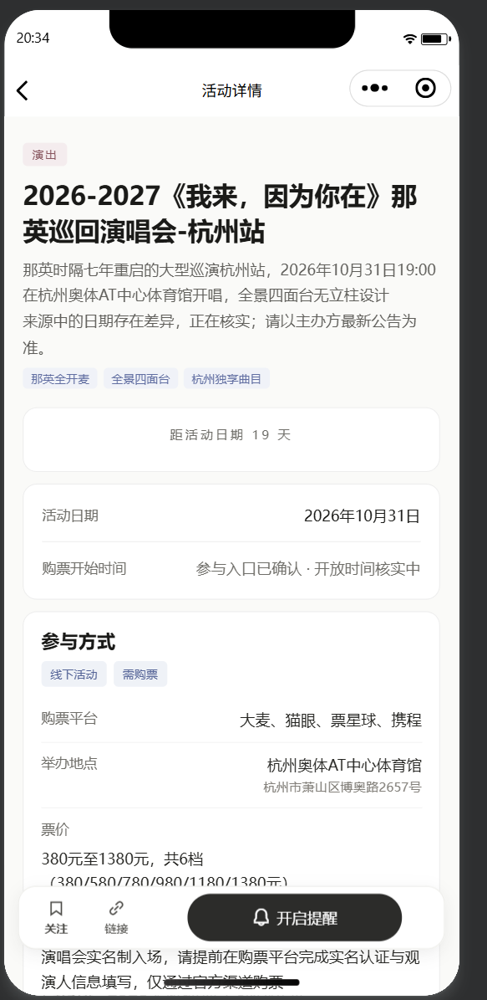
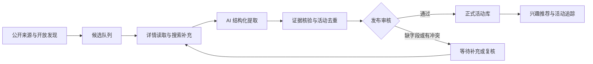

<h1 align="center">追踪事件簿</h1>
<p align="center"><strong>发现感兴趣的活动，给期待留个位置。</strong></p>
<p align="center">面向年轻人的多领域活动发现与追踪微信小程序。<br/>从一场比赛、一场展览，到一次线下体验，让分散的信息更容易发现、判断和持续关注。</p>
<p align="center">
  
  
  
</p>
<p align="center"><a href="#产品预览">产品预览</a> · <a href="#主要功能">主要功能</a> · <a href="#活动数据如何维护">数据流程</a> · <a href="#本地开发">本地开发</a></p>

## 产品预览

<table>
<tr><th width="33%">发现活动</th><th width="33%">我的关注</th><th width="33%">活动详情</th></tr>
<tr>
<td align="center"></td>
<td align="center"></td>
<td align="center"></td>
</tr>
<tr><td align="center">按领域浏览，找到感兴趣的事。</td><td align="center">先保存兴趣，再决定是否参加。</td><td align="center">把时间、地点和参与条件看清楚。</td></tr>
</table>

<sub>以上为历史真实页面截图，部分旧页面使用“活动雷达”名称；正式作品名为“追踪事件簿”。截图中的日期、状态和活动内容仅作界面展示，不代表实时信息。</sub>

## 为什么做这个产品

活动消息散落在官网、资讯平台和主办方公告里。发现时可能已经结束，收藏后又容易忘记时间；想参加，还要继续查地点、报名入口和参与限制。

追踪事件簿把这些步骤接在一起：**按兴趣发现 → 查看参与条件 → 关注并持续查看 → 自主选择提醒**。成长机会与生活体验放在同一个入口里，用户按自己的兴趣选择。

## 主要功能

| 功能 | 可以做什么 |
| --- | --- |
| 多领域发现 | 浏览科技、游戏、演出、文娱、体育及竞赛成长等领域活动 |
| 搜索与排序 | 搜索活动，按综合、时间或热度浏览 |
| 兴趣偏好 | 选择领域与细分兴趣，结合行为信号参与推荐排序 |
| 活动详情 | 查看日期、阶段进程、地点、费用、参与条件和来源入口 |
| 关注与收藏 | 保存感兴趣的活动，区分全部关注与已结束收藏 |
| 订阅提醒 | 用户主动授权后使用微信订阅消息，关注与提醒独立 |
| 数据维护 | 对候选活动进行核验、去重、受众适配判断与发布审核 |

## 活动数据如何维护

具名目标用于持续追踪，开放发现用于寻找名单之外的活动。候选线索结合详情读取、搜索和 AI 提取，经过核验后进入正式活动库。



- **搜索与提取**：代码支持腾讯 WSA、Exa、Tavily 等搜索路径，以及 DeepSeek 提取；实际启用组合和额度由部署环境决定，并非每个活动都调用全部服务。
- **事实与日期**：区分发布时间、报名截止、活动展期和独立场次，保留来源与核验依据，缺失或冲突的信息继续核验。
- **身份与质量**：结合名称、来源身份、时间地点去重，通过统一写入检查控制乱码、日期和一致性问题。
- **受众适配**：明确面向其他人群的活动阻止自动发布，人群混合的记录进入复核。这是保守规则，不能保证覆盖所有隐含受众。

流程仍依赖来源可访问性、搜索额度和候选处理效率。新来源的人工试点与正式定时接入有不同状态，代码中存在的来源不一定已自动运行。

## 技术栈

| 层级 | 技术与职责 |
| --- | --- |
| 小程序 | 微信小程序原生页面、TDesign、Day.js |
| 云端 | 腾讯云 CloudBase、云函数、云数据库、微信云开发 SDK |
| 搜索与 AI | WSA / Exa / Tavily 搜索路径，DeepSeek 信息提取，按配置启用 |
| 文本处理 | OpenCC-JS、iconv-lite |
| 本地工具 | Node.js 脚本、数据审核工具与活动看板 |

## 本地开发

### 1. 获取代码并安装前端依赖

```bash
git clone https://github.com/oppd0616/oppd.git
cd oppd/miniprogram
npm ci
```

### 2. 导入微信开发者工具

以仓库根目录导入项目，在 `project.config.json` 中配置自己的小程序 AppID，然后使用开发者工具构建 npm。小程序目录为 `miniprogram/`，云函数目录为 `cloudfunctions/`。

### 3. 配置自己的云环境

1. 创建 CloudBase 环境，检查并替换 `cloudbaserc.json`、前端及工具中的环境标识。
2. 在需要部署的云函数目录安装依赖，再部署到自己的环境，例如在 `cloudfunctions/fetchEvents/` 执行 `npm install`。
3. 按启用功能安全配置搜索与模型凭据、数据库权限、订阅消息模板和定时触发器。
4. 本地工具的凭据放在未提交的 `.env` 或服务提供方的登录配置中。

仓库提供代码，**不包含已配置的云环境或数据库**。部分脚本会修改云端数据，运行前应阅读代码，并先在自己的测试环境验证。

## 项目结构

```text
.
├── miniprogram/           小程序页面、组件与资源
├── cloudfunctions/       发现核验、查询、关注、偏好与订阅消息
├── shared/               活动身份、阶段状态与推荐等共享逻辑
├── scripts/              验证、数据审核及部署工具
├── tools/event-dashboard/ 本地活动数据看板
└── .github/assets/       README 产品截图
```

<details>
<summary><strong>验证示例与仓库范围</strong></summary>

安装对应云函数依赖后，可按需运行：

```bash
node scripts/verify-product-audience.cjs
node scripts/verify-event-write-quality.js
```

数据库导出、凭据、运行备份、报名材料及历史测试产物没有提交。部分历史验证脚本依赖本地测试产物，不能在干净克隆中直接运行。

</details>

## 反馈

欢迎通过 [Issues](https://github.com/oppd0616/oppd/issues) 提交界面问题、活动信息问题或建议。反馈活动问题时，请附活动名称、来源链接和出现问题的页面，不要提交个人隐私或访问凭据。

## 第三方成果

项目使用微信小程序、CloudBase、TDesign、Day.js、OpenCC-JS、iconv-lite、微信云开发 SDK，以及按配置启用的搜索与模型服务。第三方依赖遵循各自许可证与服务条款；活动名称和公开信息的权利归原权利方。此仓库未授予第三方内容的额外使用权。
